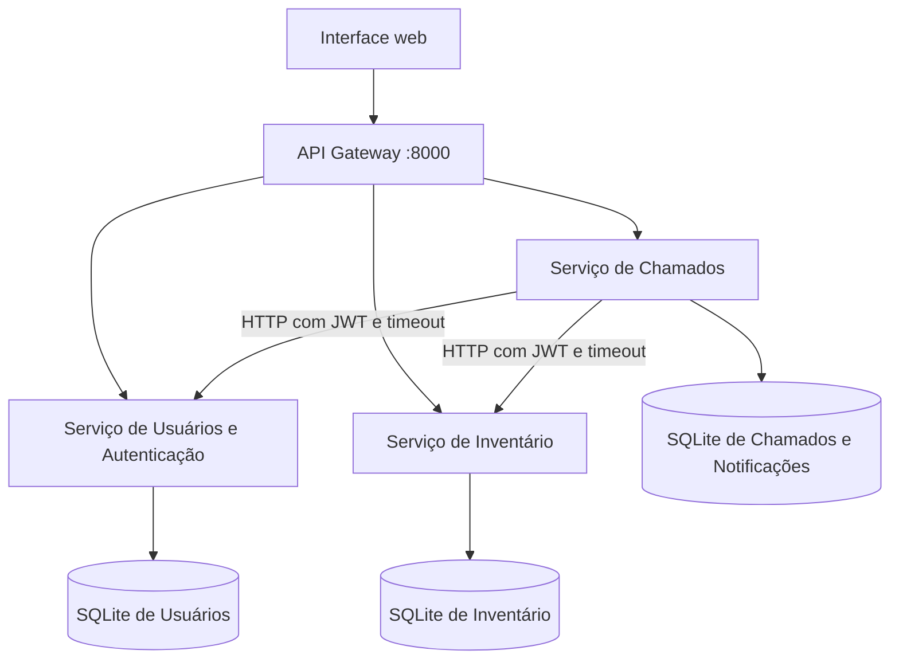

# HelpDesk TI em microsserviços

Migração do sistema monolítico para três serviços independentes em **Python, FastAPI e SQLAlchemy**. Desenvolvido para a atividade de Arquitetura de Software.

**Vídeo de demonstração (4 a 6 minutos):** adicionar aqui o link após a gravação.

## Arquitetura



- **Usuários:** cadastro, login, autenticação e perfis.
- **Inventário:** cadastro e consulta de equipamentos.
- **Chamados:** abertura, atribuição, status, comentários, SLA, painel e avisos persistidos no seu próprio banco.
- **Gateway:** ponto de entrada único, documentação OpenAPI integrada e interface original.

O código original do monólito permanece em `app/` como referência histórica e não é executado pelo Compose novo. Cada microsserviço possui sua própria pasta `app/`, suas dependências, seu Dockerfile e seu banco SQLite. Nenhum serviço importa código de outro projeto nem acessa seu banco.

## Execução

É necessário ter Docker com Docker Compose instalado.

```bash
docker compose up --build
```

Acesse:

- Interface: **http://localhost:8000**
- Documentação das APIs: **http://localhost:8000/docs**
- Estado dos serviços: **http://localhost:8000/saude**

O Compose inicializa os três microsserviços, o gateway, volumes independentes de dados e um pequeno contêiner que gera o segredo JWT aleatório compartilhado. O segredo é mantido em volume Docker e não vai para o GitHub. Apenas o gateway publica uma porta no computador.

Se quiser personalizar a configuração, copie `.env.example` para `.env`. Se definir `JWT_SEGREDO`, use pelo menos 32 caracteres aleatórios e o mesmo valor em todos os serviços.

### Contas de demonstração

Usuários e equipamentos são carregados na primeira inicialização de seus bancos quando `DADOS_EXEMPLO=1`. Senha de demonstração: `Helpdesk2026`.

| E-mail | Perfil |
|---|---|
| admin@empresa.com | Administrador |
| carla@empresa.com | Técnico |
| diego@empresa.com | Técnico |
| ana@empresa.com | Solicitante |
| bruno@empresa.com | Solicitante |

Use Carla para o fluxo de atendimento e Ana ou Bruno para verificar o isolamento dos chamados. **As credenciais são apenas para testes locais.** Para produção, configure `DADOS_EXEMPLO=0`, um segredo forte, HTTPS, backups e um banco adequado à carga.

## Rotas públicas

| Caminho | Responsável |
|---|---|
| `/auth/*`, `/usuarios*` | Usuários |
| `/ativos*` | Inventário |
| `/chamados*`, `/notificacoes*` | Chamados |
| `/`, `/app.js`, `/estilo.css`, `/docs`, `/saude` | Gateway |

O gateway mantém os caminhos usados pela interface original. Os endpoints exigem um token JWT, exceto login, saúde, documentação e a página inicial. O token é validado em **cada** serviço; Chamados também o repassa nas consultas HTTP aos outros serviços.

## Decisões técnicas

1. **Banco por serviço:** usuários, equipamentos e chamados são persistidos em três volumes SQLite diferentes. Em Chamados, `solicitante_id`, `tecnico_id` e `ativo_id` são referências lógicas, sem chaves estrangeiras apontando para outros bancos.
2. **HTTP síncrono:** ao abrir um chamado com equipamento, Chamados consulta Inventário; ao atribuir um técnico, consulta Usuários. As requisições levam o token do usuário e usam timeouts. Falhas de comunicação retornam **503**.
3. **Autorização distribuída:** cada serviço confere assinatura, emissor, validade e perfil do JWT. Usuários verifica também no banco se a conta segue ativa durante login e consultas ao próprio serviço. Nos demais, alterações de perfil entram em vigor após a expiração do token atual (padrão de 60 minutos).
4. **Disponibilidade parcial:** abrir um chamado sem equipamento e listar chamados continuam funcionando se Inventário estiver indisponível.
5. **Notificações:** continuam como dados próprios do serviço de Chamados. Uma fila assíncrona para um quarto serviço de Notificações é evolução futura, bônus não implementado.

## Como testar

```bash
# Testes do monólito original (referência)
pip install -r requirements-dev.txt
pytest -q tests

# Testes da arquitetura nova com o Compose em execução
pytest -q tests-integracao/test_fluxo.py

# Falha controlada de um serviço
docker compose stop inventario
pytest -q tests-integracao/test_falha.py
docker compose start inventario
```

O GitHub Actions executa os testes, verifica dependências com `pip-audit`, sobe todos os contêineres e simula a interrupção do Inventário.

Para iniciar um serviço isoladamente, entre na pasta `servicos/usuarios`, `servicos/inventario` ou `servicos/chamados`, instale o `requirements.txt`, defina `JWT_SEGREDO` com pelo menos 32 caracteres e execute `uvicorn app.main:app --port 8000`. Para fluxos com dependências HTTP, também configure `URL_USUARIOS` e `URL_INVENTARIO` conforme a rede.

## Vídeo de entrega

Grave 4 a 6 minutos mostrando, nesta ordem:

1. Diagrama de arquitetura e papel de cada serviço.
2. `docker compose up --build` e `docker compose ps`.
3. Login, criação, atribuição, resolução e fechamento de um chamado pela interface.
4. Acesso sem token (401) e usuário que não consegue ver chamado de outra pessoa.
5. Bancos separados, via `docker volume ls` ou `docker compose config`.
6. `docker compose stop inventario`: listagens continuam funcionando e abertura com ativo retorna 503.
7. `docker compose start inventario` e explicação sobre vantagens e custos da separação.

Coloque o link do vídeo no início deste README antes da entrega. Consulte também [DESAFIO.md](DESAFIO.md) e [SECURITY.md](SECURITY.md).
